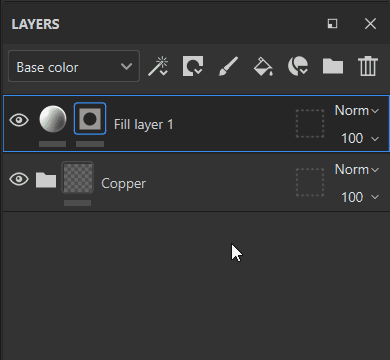
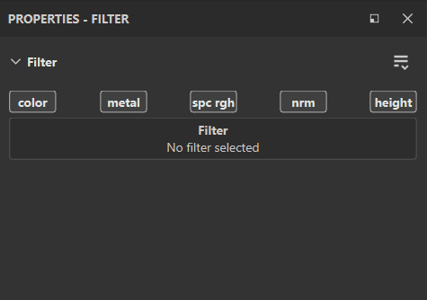
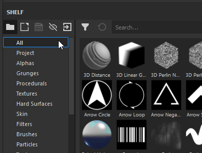
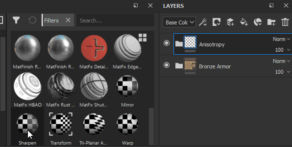

# 滤镜

滤镜效果是变换图层或蒙版内容的物质。 使用通过混合模式，图层可以修改图层堆叠的结果；在具有通过混合模式的图层上使用滤镜因此允许您使用滤镜从整体上修改图层堆叠。

## 如何应用滤镜？

根据滤镜类型，必须在图层的内容或蒙版上创建滤镜效果。 有两种方法可应用滤镜：

* 手动方法需要多个步骤来设置过滤器，但可直接控制流程的每个步骤。
* 拖放方法允许您快速添加滤镜，并自动将混合模式设置为在所有通道上穿透。

### 手动应用滤镜

在以下示例中，模糊滤镜应用于图层的内容，但更常用于将滤镜应用于蒙版：

**1. 添加滤镜效果**

首先，选择图层或图层蒙版的内容，然后单击&#x200B;**“效果”按钮**（或右键单击以打开上下文菜单）。 在列表中选择选项“ **添加筛选器**”。

**2. 在属性窗口**&#x200B;中选择筛选器

在&#x200B;**属性面板**&#x200B;中，尚未选择过滤器。 单击“滤镜选择”按钮打开微型工具架并选择所需的滤镜，这里我们选择&#x200B;**模糊滤镜**。

>[!NOTE]
>
> 手动应用滤镜时，请记住，如果您希望滤镜影响其下方图层的内容，则可能需要使用穿透混合模式。

## 从层架中拖放滤镜

此方法仅适用于应应用于整个图层栈栈的滤镜。 它将自动设置所有通道[混合模式](../../interface/layer-stack/blending-modes.md) 。 此操作不适用于将滤镜应用于蒙版。

**1. 打开工具架**&#x200B;的筛选器区域

在工具架中，单击左侧的“过滤器”部分。

**2. 拖放筛选器**

选择要在工具架中使用的过滤器。 将其拖放到图层栈栈中，确保将其放置在正确位置（例如，避免将其拖放到不需要的组中）。

请注意，在上例中，拖放的滤镜已具有“通过混合”模式。 这适用于文档的所有渠道。

## 添加新过滤器

所有滤镜都是Substance，可使用Substance 3D Designer创建滤镜。 作为快速启动，Substance 3D Designer提供了可立即用于Substance 3D Painter的模板。

有关详细信息，请参阅此页面： [创建自定义效果](../../content/creating-custom-effects/creating-custom-effects.md)

## 可用过滤器

### Standard

* [模糊](filters/standard/blur.md)
* [模糊方向](filters/standard/blur-directional.md)
* [模糊斜率](filters/standard/blur-slope.md)
* [夹持](filters/standard/clamp.md)
* [色彩平衡](filters/standard/color-balance.md)
* [颜色校正](filters/standard/color-correct.md)
* [对比度明度](filters/standard/contrast-luminosity.md)
* [投影](filters/standard/drop-shadow.md)
* [填充区域颜色](filters/standard/fill-area-color.md)
* [填充区域蒙版](filters/standard/fill-area-mask.md)
* [FXAA（消除锯齿）](filters/standard/fxaa-anti-aliasing.md)
* [发光](filters/standard/glow.md)
* [渐变](filters/standard/gradient.md)
* [渐变动态](filters/standard/gradient-dynamic.md)
* [灰度转换](filters/standard/grayscale-conversion.md)
* [高通](filters/standard/highpass.md)
* [直方图扫描](filters/standard/histogram-scan.md)
* [直方图偏移](filters/standard/histogram-shift.md)
* [HSL Perceptive](filters/standard/hsl-perceptive.md)
* [反相](filters/standard/invert.md)
* [镜像](filters/standard/mirror.md)
* [像素化](filters/standard/pixelate.md)
* [色调分离](filters/standard/posterize.md)
* [锐化](filters/standard/sharpen.md)
* [平滑步骤](filters/standard/smoothstep.md)
* [Threshold](filters/standard/threshold.md)
* [变换](filters/standard/transform.md)
* [变形](filters/standard/warp.md)

### 结束语

* [MatFinish拉丝线性](filters/finishes/matfinish-brushed-linear.md)
* [MatFinish镀锌](filters/finishes/matfinish-galvanized.md)
* [MatFinish粒状](filters/finishes/matfinish-grainy.md)
* [MatFinish磨光](filters/finishes/matfinish-grinded.md)
* [MatFinish Hammered](filters/finishes/matfinish-hammered.md)
* [MatFinish多孔圆](filters/finishes/matfinish-perforated-circles.md)
* [MatFinish粉末涂层](filters/finishes/matfinish-powder-coated.md)
* [MatFinish Raw](filters/finishes/matfinish-raw.md)
* [MatFinish粗加工](filters/finishes/matfinish-rough.md)

### MatFX

* [MatFX漫画书](filters/matfx/matfx-comic-book.md)
* [MatFX详细信息Edge Wear](filters/matfx/matfx-detail-edge-wear.md)
* [MatFX边缘损坏](filters/matfx/matfx-edge-damages.md)
* [MatFX HBAO](filters/matfx/matfx-hbao.md)
* [MatFX石油绘画](filters/matfx/matfx-oil-paint.md)
* [MatFX剥落绘画](filters/matfx/matfx-peeling-paint.md)
* [MatFX风化](filters/matfx/matfx-rust-weathering.md)
* [MatFX Shut Line](filters/matfx/matfx-shut-line.md)
* [MatFX水彩](filters/matfx/matfx-watercolor.md)
* [MatFX水滴](filters/matfx/matfx-water-drops.md)

### 光照

* [烘焙光照环境](filters/lighting/baked-lighting-environment.md)
* [风格化烘焙光照](filters/lighting/baked-lighting-stylized.md)

### 高级

* [各向异性科威特语](filters/advanced/anisotropic-kuwahara.md)
* [斜面](filters/advanced/bevel.md)
* [斜面平滑](filters/advanced/bevel-smooth.md)
* [颜色匹配](filters/advanced/color-match.md)
* [方向距离](filters/advanced/directional-distance.md)
* [渐变曲线](filters/advanced/gradient-curve.md)
* [Height调整](filters/advanced/height-adjustments.md)
* [Height为正常](filters/advanced/height-to-normal.md)
* [蒙版轮廓](filters/advanced/mask-outline.md)
* [PBR 验证](filters/advanced/pbr-validate.md)
* [量化](filters/advanced/quantize.md)
* [风格化](filters/advanced/stylization.md)
* [三平面高级](filters/advanced/tri-planar-advanced-filter.md)
