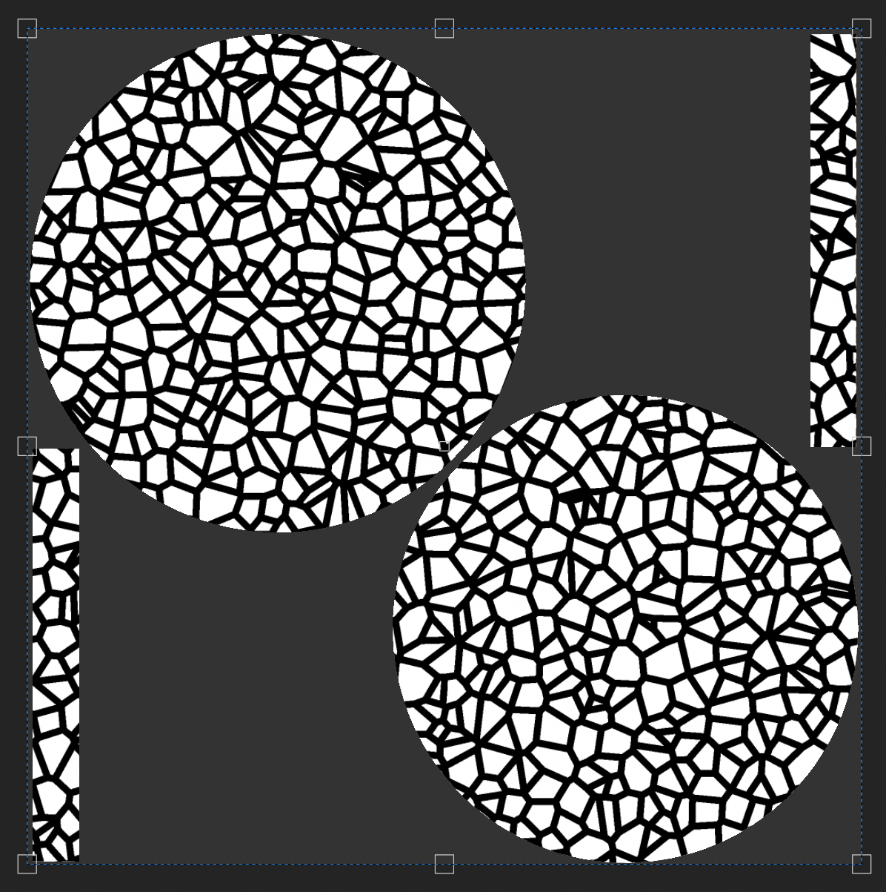
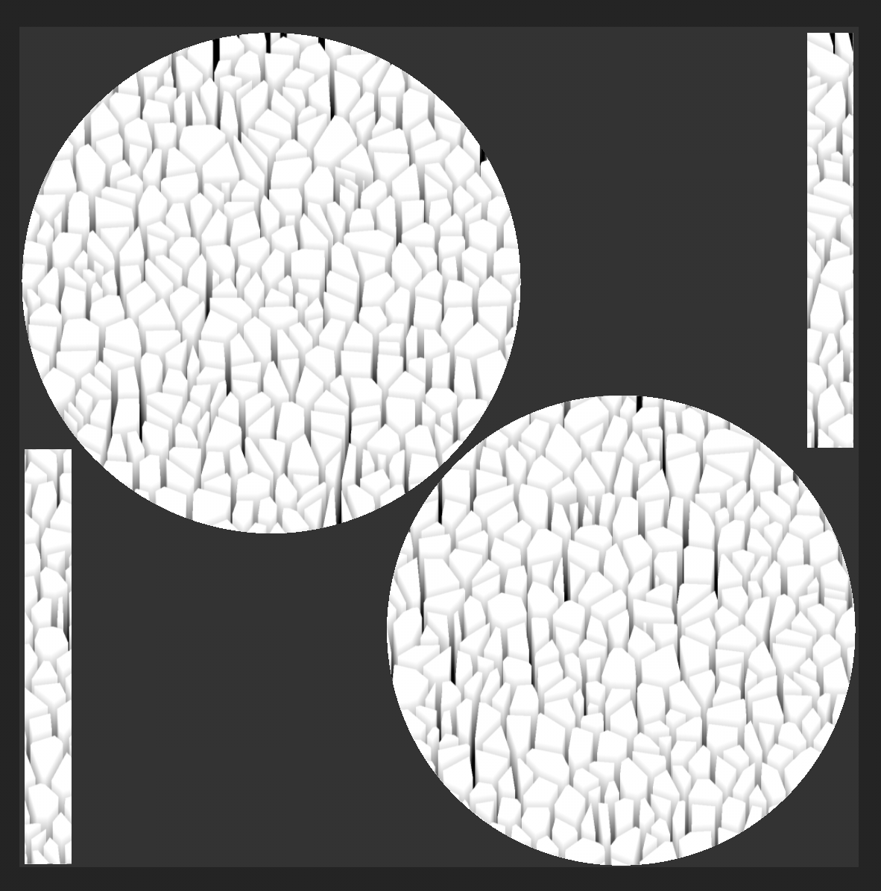

# 方向距离

<table>
  <tr style="border: 0;">
    <td style="border: 0;" valign="top"> <strong>进入：</strong>效果/颜色、距离、方向、泄漏、雨水</td>
    <td style="border: 0;" valign="top">说明 方向距离滤镜创建沿所选方向移动的距离渐变。 它在纹理图层上用于创建定向条纹、泄漏和其他基于距离的效果。 您也可以使用方向距离滤镜作为Height声道的蒙版，向普通声道添加维度。</td>
  </tr>
</table>

## 输入

| 输入名称 | 描述 |
| --- | --- |
| **距离图：**&#x200B;灰度 | 使用自定义纹理或锚点。 |

## 参数

| 参数名称 | 描述 |
| --- | --- |
| **距离：** | 在归一化图像空间中，调整距离渐变所经过的距离，其中1是输入图像较短一侧的长度。 |
| **角度：** | 依次调整距离渐变的方向，其中0指向水平方向的右侧，或沿(1,0)矢量方向。 |
| **对比度：** | 调整结果的对比度或衰减。 |
| **距离图乘数：** | 调整距离图对最大距离的影响程度。 当距离图输入未连接时，此参数不起作用。 |

## 示例

在下面的示例中，我们使用方向距离筛选器使细胞2生成器呈三维效果。

这可以通过创建启用Height声道并将其设置为值1的填充图层来实现。

然后向填充图层添加黑色蒙版，并在蒙版中添加灰度设置为&#x200B;**细胞2**&#x200B;的填充。 这将创建以下蒙版。

>[!NOTE]
>
> 按住alt键并单击蒙版图标，即可在&#x200B;**视口**&#x200B;中查看蒙版，或者选择填充图层后，使用&#x200B;**视口**&#x200B;中的声道下拉菜单选择&#x200B;**蒙版**。

接下来，向蒙版添加滤镜，然后选择方向距离滤镜。

根据所需结果调整滤镜设置，但蒙版的外观应类似于以下示例。

切换回材料视图以查看视口中的效果。
