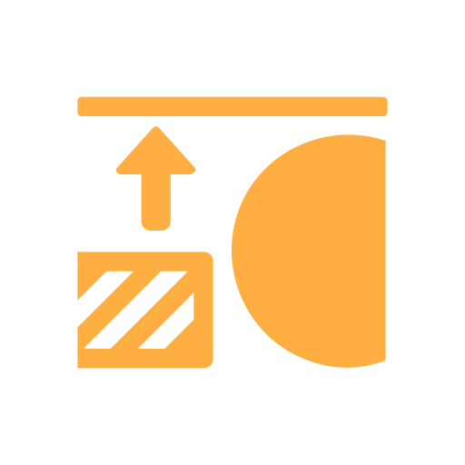

# Height为正常

<table>
<tr style="border: 0;">
<td width="33.33%" style="border: 0;" valign="top">

<b>进入：</b>效果/

</td>
<td width="100.00%" style="border: 0;" valign="top">

## 描述

“Height到正常”滤镜根据Height通道生成精确的正常数据。

它用于纹理层，将Height信息转换为常规数据。

</td>
</tr>
</table>

## 参数

| 参数名称 | 描述 |
| --- | --- |
| <b>覆盖现有正常：</b> | 切换覆盖现有的常规数据。 |
| <b>使用世界单位：</b> | 切换转换世界单位的使用。 |
| <b>正常强度：</b> | 如果&#x200B;**使用世界单位**&#x200B;为&#x200B;**False**，则使用此值可调整生成的正常数据的强度。 |
| <b>表面大小（厘米）：</b> | 如果&#x200B;**使用世界单位**&#x200B;为&#x200B;**True**，则使用此值调整所表示曲面的宽度或Height（以较大者为准）。 |
| <b>深度(cm)：</b> | 如果&#x200B;**使用世界单位**&#x200B;为&#x200B;**True**，则使用此值可调整表面的最大Height范围。 |
