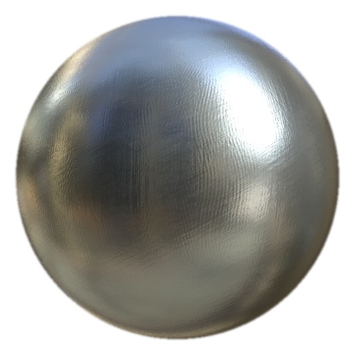

# MatFinish磨光

<table>
<tr style="border: 0;">
<td width="33.33%" style="border: 0;" valign="top">

<b>进入：</b>效果/光洁度，表面

</td>
<td width="100.00%" style="border: 0;" valign="top">

## 描述

MatFinish“磨光”滤镜是金属光饰收集器的一部分，用于创建磨光金属效果。

它用于填充图层。 调整基本填充图层的粗糙度、颜色、金属和其他属性，然后添加滤镜进行最终的表面处理。

</td>
</tr>
</table>

## 输入

| 输入名称 | 描述 |
| --- | --- |
| <b>位置：</b>颜色 | 使用烘焙的位置图。 |
| <b>世界空间法线：</b>颜色 | 使用烘焙的世界空间法线映射。 |

## 参数

| 参数名称 | 描述 |
| --- | --- |
| <b>种子：</b> | 指定一个随机值，以在不更改整体设置的情况下创建不同的变化。 |
| <b>缩放：</b> | 调整抛光的整体比例。 |
| <b>研磨强度：</b> | 调整磨削效果的强度。 |
| <b>三平面映射：</b> | 切换三平面映射。 |

