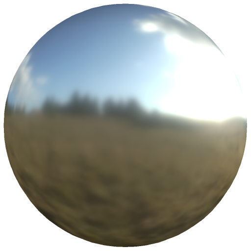

# 烘焙光照环境

<table>
<tr style="border: 0;">
<td width="33.33%" style="border: 0;" valign="top">

<b>范围：</b>效果/光照、烘焙、环境、PBR

</td>
<td width="100.00%" style="border: 0;" valign="top">

## 描述

烘焙光照环境滤镜将材料和环境光照信息烘焙到颜色通道中。

它用于设置为直通模式的绘画图层并应用于所有通道。 对于风格化工作流程，其中不需要准确的模拟光照或资源有限时（例如，在移动项目上或仅依赖颜色图的资源上），此选项很有用。

</td>
</tr>
</table>

## 输入

| 输入名称 | 描述 |
| --- | --- |
| <b>Ambient occlusion：</b>灰度 | 使用烘焙的Ambient occlusion映射。 |
| <b>环境图：</b>灰度 | 使用环境图。 |
| <b>正常：</b>颜色 | 使用法线图。 |

## 参数

| 参数名称 | 描述 |
| --- | --- |
| <b>水平旋转：</b> | 调整环境光线的水平旋转。 |
| <b>垂直旋转：</b> | 调整环境光照的垂直旋转。 |
| <b>曝光度：</b> | 调整烘焙结果的曝光度。 |
| <b>Height强度：</b> | 调整Height信息对结果的影响程度。 |
| <b>Ambient occlusion强度：</b> | 调整烘焙中的ambient occlusion强度。 |
| <b>遮蔽强度：</b> | 调整烘焙中Specular遮蔽的强度。 |
