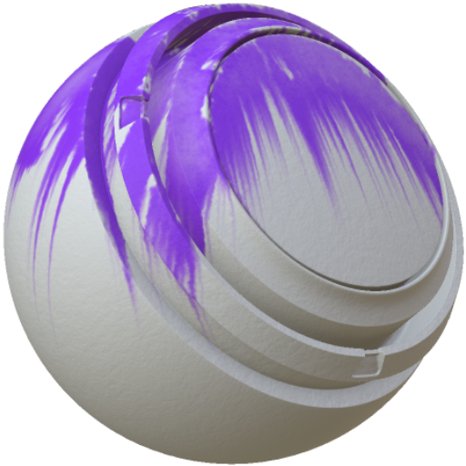

# MatFX水彩

<table>
<tr style="border: 0;">
<td width="33.33%" style="border: 0;" valign="top">

<b>进入：</b>效果/模糊，灰度

</td>
<td width="100.00%" style="border: 0;" valign="top">

## 描述

MatFX水彩滤镜以水彩外观风格化源图像。

它用于纹理图层以创建水彩溢出、纸张交互和柔和的绘画边缘。

</td>
</tr>
</table>

## 参数

| 参数名称 | 描述 |
| --- | --- |
| <b>绘画不透明度：</b> | 调整绘画的不透明度。 |
| <b>纸张吸收：</b> | 调整纸张吸收绘画的强度。 |
| <b>累积类型：</b> | 选择累计方法。 |
| <b>边框扩展：</b> | 调整绘画边框的分布。 |
| <b>边框密度：</b> | 调整绘画边框的密度。 |
| <b>显示跨绘画边缘：</b> | 切换跨绘画边缘的显示。 |
| <b>隐藏纸张：</b> | 切换纸张纹理的可见性。 |
| <b>自定义纸张：</b> | 切换使用自定义纸张纹理。 |
