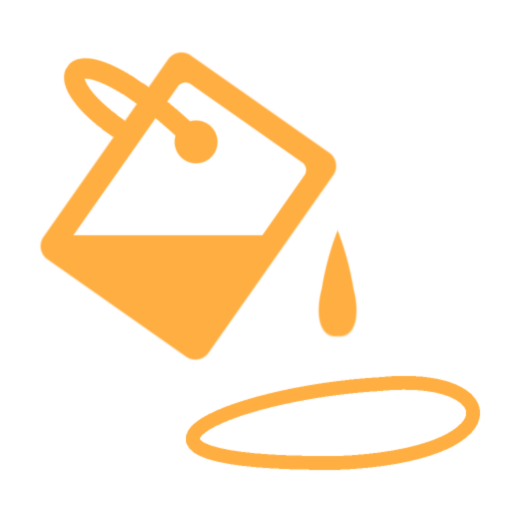

# 填充区域颜色

<table>
<tr style="border: 0;">
<td width="33.33%" style="border: 0;" valign="top">

<b>范围：</b>效果/填充、形状、轮廓、rgba、颜色

</td>
<td width="100.00%" style="border: 0;" valign="top">

## 描述

“填充区域颜色”滤镜将轮廓转换为填充形状。 任何具有连续边框的区域都会被填充。 颜色版本使用Alpha来确定区域边界。

它用于绘画图层（颜色通道）上，以填充闭合的绘画描边。

</td>
</tr>
</table>

## 参数

| 参数名称 | 描述 |
| --- | --- |
| <b>区域检测：</b> | 选择如何识别要填充的区域。 |
| <b>区域检测阈值：</b> | 调整区域检测阈值。 |
| <b>调试区域检测：</b> | 切换区域检测设置检测到的轮廓的显示。 这有助于确定可能未完全闭合的区域。 |
| <b>UV边框行为：</b> | 选择如何在区域填充期间处理UV边界。 |
| <b>UV边框阈值：</b> | 调整用于忽略UV区域的阈值，否则这些区域将由区域检测过程填充。 |
| <b>颜色模式：</b> | 选择用于填充区域内部的方法。 |
| <b>填充颜色：</b> | 调整填充颜色。 |
| <b>模糊强度：</b> | 调整模糊强度。 |
| <b>模糊示例：</b> | 调整模糊样本数。 |
| <b>迭代：</b> | 调整要执行的迭代数。 值越高，结果越好，但速度越慢。 有用的值在[8， 48]范围内。 |
