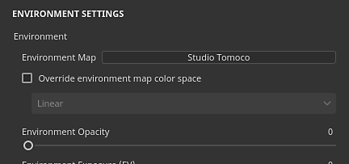
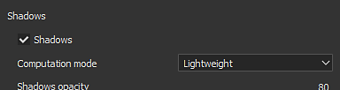

# 环境设置

**显示设置**&#x200B;的此部分控制视口中的光照。

## 环境

| *设置* | *描述* |
| --- | --- |
| **环境图** | 用于照亮场景的环境图纹理。 可以使用“环境”预设在[资源](../assets/assets.md)窗口中找到。单击按钮以打开一个微型工具架并选择其他环境图。 |
| **覆盖环境图色彩空间** | 如果当前项目使用[色彩管理](../../features/color-management/color-management.md)，则可以启用此设置以覆盖环境图的色彩空间。 |
| **环境不透明度** | 控制环境纹理在视口背景中的可见性/不透明度。 此设置对场景的光照没有影响。 |
| **环境曝光** | 曝光值(EV)是表示固定明亮度的数字。 此设置允许偏移默认明亮度值。在使用随应用程序提供的环境图时，此设置应保持为0。 使用不正确的曝光值为资源添加纹理可能会导致其他应用程序出现颜色校准问题。 |
| **环境轮换** | 控制环境纹理的水平旋转。 适用于旋转场景中的光照并更改对象的反应方式。 可以使用[快捷键](../settings/shortcuts.md)控制。 |
| **环境模糊** | 控制环境纹理在视口背景中呈现的清晰度或模糊度。 此设置对光照没有影响。 |
| **环境对齐方式** | 控制环境纹理如何围绕视口内的3D模式旋转。 当设置为局部时，此设置可用于照亮3D模型下的区域。可能的值：<ul data-preserve-html="true"><li data-preserve-html="true"><strong>全局</strong>（默认）：环境与场景对齐，并围绕3D模型的向上轴旋转。</li><li data-preserve-html="true"><strong>本地</strong>：环境与相机对齐，并围绕相机的向上轴旋转。</li></ul> |

## 阴影

| *设置* | *描述* |
| --- | --- |
| **阴影** | 启用/禁用视口中的阴影渲染。 |
| **计算模式** | 控制计算阴影的速度。<ul data-preserve-html="true"><li data-preserve-html="true"><strong>密集型</strong> ：计算速度较快，但可以冻结视口渲染。</li><li data-preserve-html="true"><strong>平均</strong> ：密集模式和轻量模式的平均值。</li><li data-preserve-html="true"><strong>轻量级</strong> ：（默认）计算在几秒钟内使阴影变慢，但不会降低视口性能。</li></ul> |
| **阴影不透明度** | 控制场景中可见的阴影量。 |
