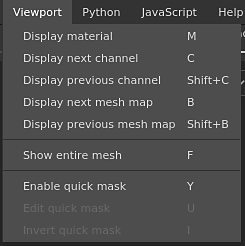

# 视口菜单

视口菜单可用于更改[视口](https://substance3d.adobe.com/)的显示模式。

| 操作 | 描述 |
| --- | --- |
| **显示材料** | 将视口切换到&#x200B;**材料**&#x200B;模式，该模式显示具有光照和着色的3D模型。 |
| **显示下一个频道** | 将视口切换到独奏模式以显示下一个纹理集声道。 |
| **显示上一个频道** | 将视口切换到独奏模式以显示上一个纹理集声道。 |
| **显示下一个网格图** | 将视口切换到独奏模式，以显示下一个烘焙的网格图类型。 |
| **显示上一个网格图** | 将视口切换到独奏模式，以显示上一个烘焙的网格图类型。 |
| **显示整个网格** | 调整相机以使其在3D模型上居中。 |
| **已启用的快速蒙版** | 有关详细信息，请参阅[快速蒙版](../../painting/tool-list/quick-mask.md)页。 |
| **编辑快速蒙版** | 有关详细信息，请参阅[快速蒙版](../../painting/tool-list/quick-mask.md)页。 |
| **反转快速蒙版** | 有关详细信息，请参阅[快速蒙版](../../painting/tool-list/quick-mask.md)页。 |

有关显示模式的详细信息，请参阅[显示设置](../display-settings/display-settings.md)。

有关快速蒙版的详细信息，请参阅[专用页面](../../painting/tool-list/quick-mask.md)。
