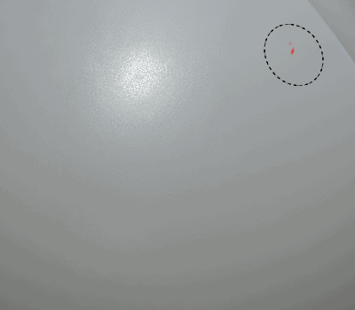

# 动态笔触

<table>
<tr style="border: 0;">
<td style="border: 0;" valign="top">

{width="400px"}

</td>
<td style="border: 0;" valign="top">

{width="350px"}

</td>
</tr>
</table>

**动态笔触**&#x200B;是常规画笔描边，由&#x200B;**Substance文件**&#x200B;提供支持，可对&#x200B;**画笔描边**&#x200B;内的每个图章&#x200B;**更改**。

可以根据Substance文件本身设计的特定行为修改画笔描边旁边的每个单独元素。

有关详细信息，请参阅以下页面：

* [启用动态笔触功能](enabling-dynamic-stroke-feature.md)
* [动态描边性能](dynamic-stroke-performances.md)
* [创建自定义动态笔触](creating-custom-dynamic-strokes.md)
