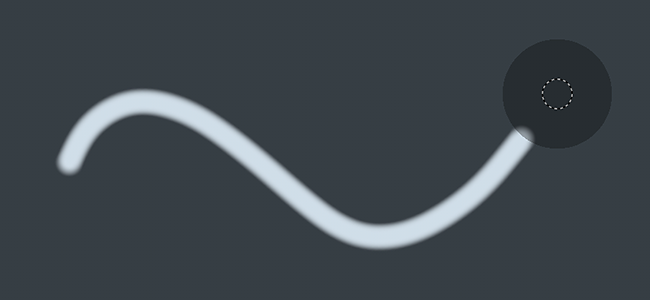

# 延迟鼠标

延迟鼠标是鼠标光标与实际绘画之间的距离偏移，允许绘画更精确或平滑的描边。

可以通过[上下文工具栏](../interface/toolbars.md)启用它。 这样使绘画变得干净连续，线条更加简单。

## 启用延迟鼠标

要启用或禁用该延迟鼠标，只需单击上下文工具栏中可用的按钮即可：

启用后，视口中的画笔光标周围应该会显示一个灰色圆圈：

## 延迟鼠标半径

可以在上下文工具栏中更改延迟鼠标距离。 距离定义刷子图章将在原始绘画位置绘制的半径。 距离越小，将越快绘制图章，这样可快速翻转，但会减少绘制线条的平滑度。

* 大距离：

  {width="400px"}
* 小距离：

  {width="400px"}
