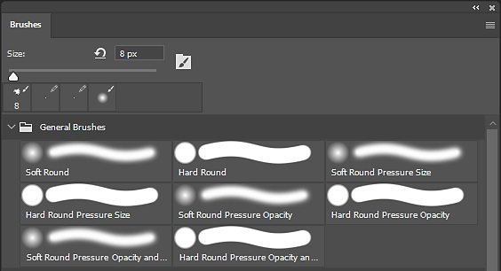

# 从Photoshop导出笔刷预设

ABR文件(笔刷预设)只能从Adobe Photoshop创建。 要创建包含预设的ABR，只需执行以下步骤即可：

1. <b>打开Adobe Photoshop。</b>

   ABR文件只能从Photoshop中创建。
1. <b>打开“画笔”面板。</b>

   从<b>窗口>画笔中打开“画笔”面板。 </b>

   {width="500px"}
1. <b>选择要导出的笔刷预设（或组）。</b>

   按住CTRL键可选择多个画笔或预设。

   {width="500px"}
1. <b>导出到ABR文件。</b>

   打开画笔窗口的“设置”菜单，然后选择<b>导出选定的画笔</b>。

   此时会显示一个文件对话框，要求您提供用于保存导出的ABR文件的文件名和位置。

   
