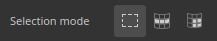
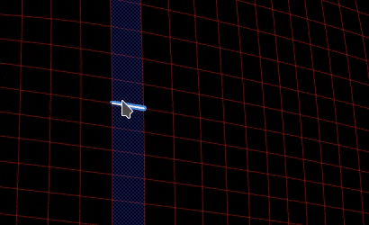
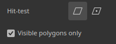

# 多边形填充

**多边形填充**&#x200B;工具使用材料的通道值或灰度蒙版值填充多边形。 它可以用于绘画图层、效果和蒙版，以快速填充网格的区域。

此工具更像是一种绘画工具，而不是选择工具：这就是使用它之后只能通过橡皮擦工具或填充工具擦除它的原因。

可以从工具工具栏访问该工具：

## 设置

下面是通过&#x200B;**属性**&#x200B;窗口使用&#x200B;**多边形填充**&#x200B;工具可用的设置列表。

### 选择模式

选取模式控制如何选取网格几何的三角形和四边形。

| **模式** | **描述** |
|---|---|
|  **矩形选框填充** | 通过单击和拖动绘制矩形选区。 **填充模式**&#x200B;定义填充的几何形状，而&#x200B;**点击测试**&#x200B;定义包含的多边形。   |
|  **多边形循环填充** | 只需单击一次即可填充完整的四边形循环。 拖动操作可选取多个环。   |
|  **部分多边形循环填充** | 通过单击和拖动来填充循环的一部分。 该选取项可沿二级环延伸，形成多边形的补片。   |

### 填充模式

填充模式只能与&#x200B;**矩形选框填充**&#x200B;模式一起使用，用于控制选定几何图形的哪些部分。

| **模式** | **描述** |
|---|---|
|  **三角形填充** | 填充单个网格三角形。 |
|  **多边形填充** | 填充整个多边形。 在导入前进行三角化的网格上，结果与&#x200B;**三角形填充**&#x200B;相同。 |
|  **网格填充** | 填充与所单击多边形相连的每个多边形。 |
|  **UV区块填充** | 填充在UV空间中连接的多边形。 填充将在UV边框处停止。 |

### 命中测试

点击测试设置控制&#x200B;**矩形选框填充**&#x200B;模式选择三角形和四边形的方式。

| **模式** | **描述** |
|---|---|
|  **交集** | （缺省）如果多边形的几何的任何部分在选区内部或与选区交叉，则会填充该多边形。 |
|  **包含的中心** | 仅当多边形的中心点位于选区内部时，才会填充该多边形。 |
| **仅可见多边形** | 如果启用，填充将仅影响当前相机视图中可见的多边形。 遮挡和背面多边形将被忽略。 如果禁用，可以通过网格填充多边形。 |

### 混合

这些设置控制填充结果与基础像素混合的方式。

| **参数** | **描述** |
|---|---|
| 混合模式 | 控制填充与现有像素值的混合方式。 在&#x200B;**材料**&#x200B;模式下，混合模式将应用于&#x200B;**材料**&#x200B;部分中启用的所有声道。 |
| 不透明度 | 控制填充的不透明度。 |

>[!NOTE]
>
> 该工具支持的混合模式与该图层堆叠中可用的混合模式相同。 有关详细信息，请参阅[混合模式文档页面](https://experienceleague.adobe.com/zh-hans/docs/substance-3d-painter/using/interface/layer-stack/blending-modes)。

### 材质

“材料”部分控制工具可以启用哪些声道来绘画。

## Shortcuts

借助特定的键盘快捷键，可以有效地使用多边形填充工具：

| **快捷键** | **描述** |
|---|---|
| **Alt** | 使用&#x200B;**多边形循环填充**&#x200B;和&#x200B;**部分多边形循环填充**，此快捷键可在拖动时扩展初始单击另一侧的选区。   |
| **转换** | 使用&#x200B;**部分多边形循环填充**，此快捷键仅填充主循环，而忽略辅助循环。 切换&#x200B;**Shift**&#x200B;的示例：    |
| **Shift + A** | 此快捷键从任何其他选择模式临时切换到&#x200B;**多边形循环填充**。 如果在鼠标按钮之前释放快捷键，则选择将继续进行，直到释放鼠标按钮为止。 |
| **A** | 如果在拖动时按下此快捷键，则当前结果与上一个结果合并。 这适用于混合模式和不透明度：    |

## 限制

此工具存在一些限制：

* **多边形环填充**&#x200B;和&#x200B;**部分多边形环填充**&#x200B;仅适用于四边形，因此三角形和n边形无法填充这些模式。
* **径向对称**&#x200B;的支持也受到限制，并且可能不可靠。 要使用对称，最好改用镜像模式。 有关详细信息，请参阅[对称文档页面](https://experienceleague.adobe.com/zh-hans/docs/substance-3d-painter/using/painting/symmetry/symmetry)。
* 此工具仅填充&#x200B;**活动纹理集**&#x200B;中的几何。 此时会显示该纹理集的线框，并在活动纹理集更改时进行更新。
