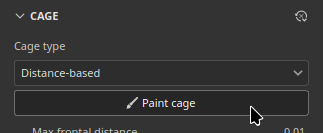
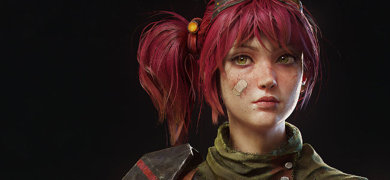
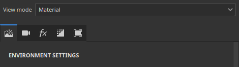

# 版本 12.2

**Substance 3D Painter 12.2**&#x200B;改进了“多边形填充”工具，该工具具有基于循环的选区、用于烘焙的笼子绘画、视口中的纹理集突出显示以及实时渲染的不依赖于顺序的透明度。

发行日期：**2026年10月21日**

## 主要功能

### 改进的多边形填充

重新设计了&#x200B;**多边形填充**&#x200B;工具，为多边形环提供了新的界面和选择模式。 该工具现在还支持带不透明度控件的混合模式，可以一次处理多个通道。 选择手柄也会遮蔽，这意味着从相机隐藏的多边形将被忽略。

* **改进了接口**

  已重新处理&#x200B;**属性**&#x200B;窗口中的&#x200B;**多边形填充**&#x200B;设置，以方便使用。 这些选项现在显示为按钮行，使模式之间的切换速度更快。 新的工具提示图标描述了每种模式的工作方式。

  

* **新的选择模式**

  **选择模式**&#x200B;行中添加了两个专用于多边形循环的新模式：

  

  * **多边形循环填充**：此模式只需单击一次即可填充完整的四边形循环。 拖动时按住&#x200B;**Alt**&#x200B;键还可沿相反方向扩展选区。

    

  * **部分多边形循环填充**：此模式仅填充循环的一部分，并沿循环拖动可扩展选区。 拖动时，箭头会在选区的每一侧显示拓扑流，以帮助预期意外的路径更改。 光标旁的工具提示显示两个轴上选定的多边形数。 拖动时按住&#x200B;**Alt**&#x200B;键还可沿相反方向扩展选区。

    

  按住&#x200B;**Shift + A**&#x200B;也会从任何选择模式临时切换到&#x200B;**多边形循环填充**。 如果在鼠标按钮之前释放快捷键，则选择将继续进行，直到释放鼠标按钮为止。

* **填充模式切换选择模式**

  **填充模式**&#x200B;选项不适用于&#x200B;**多边形循环填充**&#x200B;和&#x200B;**部分多边形循环填充**&#x200B;模式。 因此，选择填充模式会自动将&#x200B;**选择模式**&#x200B;更改回主要模式。

  

* **新的命中测试选项**

  新的&#x200B;**Hit-test**&#x200B;选项控制选区中包含哪些多边形。 放弃不可见多边形现在是默认行为，因为默认情况下启用了&#x200B;**仅可见多边形**&#x200B;选项。 禁用此选项将恢复之前在网格中填充的行为。

  可用选项包括：

  * **交集**： （默认）如果多边形的任何部分位于选区内部或穿过其边缘，则会填充该多边形。
  * **包含的中心**：仅当多边形的中心点位于选区内部时，才会填充该多边形。
  * **仅可见多边形**：如果启用，此选项将仅填充当前相机视图中可见的多边形。 因此会忽略封闭和背面几何。

  

* **混合模式和不透明度**

  **多边形填充**&#x200B;工具现在支持所有混合模式，与图层堆叠中可用的列表相同。 例如，**Linear dodge（添加）**&#x200B;将值添加到现有值，而不是替换这些值。 除了&#x200B;**不透明度**&#x200B;滑块之外，这些模式在&#x200B;**属性**&#x200B;窗口的新&#x200B;**混合**&#x200B;部分中可用。 在&#x200B;**材料**&#x200B;模式下，混合模式将应用于&#x200B;**材料**&#x200B;部分中启用的所有声道。

  

* **一次填充多个通道**

  **多边形填充**&#x200B;工具不再限于单通道。 现在，可以在&#x200B;**材料**&#x200B;部分中启用的所有声道属性设置并在一个操作中填充。

  

* **与对称兼容**

  **多边形循环填充**&#x200B;和&#x200B;**部分多边形循环填充**&#x200B;也使用对称。 镜像对称只需单击一下即可（但径向对称可能不太可靠）。

  

* **恢复上一个描边**

  **恢复上一个描边**&#x200B;快捷键（保持&#x200B;**A**&#x200B;处于按下状态）现在可以使用&#x200B;**多边形填充**&#x200B;工具，包括混合模式和不透明度。

  

* **跨纹理集的反馈更清晰**

  现在仅为活动纹理集显示线框，并且当选择更改时它会更新。 悬停其它纹理集中的几何现在会显示禁用光标，指示相关几何无法填充。

  

>[!NOTE]
>
> 有关&#x200B;**多边形填充**&#x200B;工具的更多信息，请查看[专用文档页面](https://experienceleague.adobe.com/en/docs/substance-3d-painter/using/painting/paint-tools/polygon-fill)。

### 在烘焙模式下新建笼子绘画

新的&#x200B;**笼子绘画模式**&#x200B;是可在全局距离偏移量之上绘制的每像素笼子偏移。 这意味着现在可以通过直接在网格上绘画来调整笼子。 随后可以更轻松地在本地修复高模网格在笼子之外的区域。

* **笼子偏移的新绘画**

  烘焙模式中的新&#x200B;**绘画笼子**&#x200B;按钮现在切换到笼子绘画模式。 在此模式下，**绘画**、**橡皮擦**&#x200B;和&#x200B;**多边形填充**&#x200B;工具可用于调整笼子与低模网格的距离。

  

  这可以通过绘制中间纹理来完成。 然后，在烘焙期间将此纹理用作笼子网格上的偏移。 这类似于&#x200B;**倾斜绘画**&#x200B;过程。

  顶部工具栏中的&#x200B;**强度**&#x200B;参数可设置描边应用的偏移值。 常规的&#x200B;**大小**、**流量**、**笔触不透明度**&#x200B;和&#x200B;**间距度**&#x200B;控件以及一个&#x200B;**反转值**&#x200B;按钮也可用。 还支持对称。

  

  

* **使用“多边形填充”选择和填充整个网格部分**

  **多边形填充**&#x200B;工具可以一次调整部分或完整子对象的笼子距离。 单击某个元素将打开一个包含&#x200B;**强度**&#x200B;滑块的浮动工具栏。 此滑块从顶部工具栏中设置的值开始实时增大或缩小笼子。 然后，在偏移上方添加绘制的偏移。

  

* **在视口中显示笼子偏移**

  进入笼子绘画模式会将视口切换到新的视图模式。 在此模式下，偏移在笼子上显示为绿色叠加。 该笼子也变形以表示在烘焙过程中使用的笼子网格。

  

  一些设置可以通过&#x200B;**烘焙可视化**&#x200B;面板控制： **笼子**&#x200B;部分控制&#x200B;**笼子表面**&#x200B;和&#x200B;**笼子线框**&#x200B;的显示及其不透明度。 它还有&#x200B;**偏移网格不透明度**&#x200B;和&#x200B;**偏移着色强度**。

  

* **上下文工具栏中的混合模式**

  为方便起见，一些混合模式可直接在上下文工具栏中使用。 它们可用于更轻松地调整笼子偏移，特别是添加或减去偏移。

  可用模式包括：

  * **正常**：将现有偏移替换为描边值。
  * **变亮（最大）（最大值）**：保留描边和现有偏移值中的较高值。
  * **Linear dodge（添加）**： （默认）将描边值添加到现有偏移。

  

  使用视口中的右键单击菜单，**多边形填充**&#x200B;可使用其他混合模式。

* **用于笼子和倾斜绘画的新重置菜单**

  倾斜和笼子绘画模式现在都有一个重置设置的新菜单。 可用选项包括：

  * **重置笼子/倾斜参数**：将UI参数重置为默认值。
  * **清除所有笼子/倾斜绘画描边**：擦除用于笼子或倾斜绘画的纹理。
  * **重置并清除全部**：同时重置用户界面和擦除笼子/倾斜纹理。

  

>[!NOTE]
>
> 有关烘焙的更多信息，请查看[专用文档页面](https://experienceleague.adobe.com/en/docs/substance-3d-painter/using/baking/baking)。

### 视口中新的纹理集突出显示

现在，新的高亮显示行为可帮助识别3D视口中的哪些几何与&#x200B;**纹理集**&#x200B;或&#x200B;**UV 平铺**&#x200B;相关联。

* **从纹理集列表中突出显示**

  现在，将鼠标悬停在&#x200B;**纹理集列表**&#x200B;中的条目上可突出显示视口中用于纹理集和UV 平铺的几何图形。 这样可以很容易地看到网格的哪个部分属于每个纹理集。

  

* **突出显示该视口**

  在模型上按住&#x200B;**Ctrl/Cmd + Alt**&#x200B;可突出显示光标下的纹理集几何。 在按住鼠标左键或进行平移时，将隐藏此突出显示，并在释放修饰键后返回。

* **在绘画和烘焙模式下可用**

  高光在绘画和烘焙模式下均可工作。 在烘焙模式下，已禁用的纹理集在高亮时显示为灰色。

### 独立于新订单的透明度

实时视口现在支持与顺序无关的透明度。 它会消除当多个透明或半透明曲面重叠时可能出现的排序伪像和闪烁。

* **显示设置中的新选项**

  可以在&#x200B;**显示设置**&#x200B;的&#x200B;**渲染设置**&#x200B;部分中启用&#x200B;**独立于顺序的透明度**&#x200B;选项。 默认情况下，该选项处于禁用状态，以避免影响性能。

  

  启用新设置之前和之后：

  

* **性能控制**

  **排序容量**&#x200B;参数控制可按像素排序的平均透明度图层数。 值越大，复杂场景中的透明度质量越好，但会使用更多内存并降低性能。 可用选项包括：

  * **低(1x)**。
  * **中等(2x)**。
  * **高(4x)**（默认）
  * **非常高(8x)**
  * **Ultra(16x)**

### 其他改进

此版本中添加了其他功能和改进：

* **重新组织的显示设置**

  **显示设置**&#x200B;窗口的参数已重新分组和重新排序，因此该面板更易于导航。 设置现在拆分为&#x200B;**环境设置**、**相机设置**、**后期效果**、**渲染设置**&#x200B;和&#x200B;**可视化设置**。 通过窗口顶部的一行按钮，可以直接跳转到每个组。

  

* **与画笔描边叠加混合**

  画笔设置现在提供新的叠加混合模式。 在此模式下，描边将在同一图层中彼此上方相加，而不是相互替换。 这不仅仅限于描边内的图章。 通过这种新模式，可额外添加颜色，或通过添加或删除值来雕刻Height通道。

  

* **新UV邻居引擎映射**

  新的`mesh_uv_neighbor`引擎映射输入可用于Substance材料和筛选器。 它可以作为UV平流纹理来查找UV 岛接缝的另一侧。 它的红色和绿色通道存储了UV平流，用于跨UV接缝到达邻近像素。

  有关这些纹理的详细信息，请参阅[专用文档页面](https://experienceleague.adobe.com/en/docs/substance-3d-painter/using/content/creating-custom-effects/mesh-based-input)。

## 发行说明

### 12.2.0

发行日期：**2026/10/21**

摘要： **此更新是一个主要版本，它为烘焙添加了一个新的笼子绘画功能，并对多边形填充功能进行了改进。 有关详细信息，请参阅完整的发行说明。**

**已添加：**

* 烘焙，笼子绘画
* &amp;lbrack；笼子绘画&amp;rbrack；创建基本笼子绘画UI
* &amp;lbrack；笼子绘画&amp;rbrack；新的笼子可视化选项
* &amp;lbrack；笼子绘画&amp;rbrack；可编辑选择/填充工具
* &amp;lbrack；笼子绘画&amp;rbrack；在工具栏中显示混合模式
* &amp;lbrack；笼子绘画&amp;rbrack； HDR滑块UI更改
* &amp;lbrack；笼子绘画&amp;rbrack；可视化着色器
* &amp;lbrack；笼子绘画&amp;rbrack；重置堆叠选项
* 多边形填充工具改进
* &amp;lbrack；多边形填充&amp;rbrack；添加多边形修补
* &amp;lbrack；多边形填充&amp;rbrack；添加多边形环
* &amp;lbrack；多边形填充&amp;rbrack；对称支持环路/修补
* &amp;lbrack；多边形填充&amp;rbrack；对称边缘预览
* &amp;lbrack；多边形填充&amp;rbrack；删除带环和部分环的三角形
* &amp;lbrack；多边形填充&amp;rbrack；线框仅对活动纹理集可见
* 边距；多边形填充&amp;rbrack；红边加亮于不可单击的三角形(&amp;L)
* &amp;lbrack；多边形填充&amp;rbrack；不禁用填充模式选项
* &amp;lbrack；多边形填充&amp;rbrack；允许使用多边形填充设置所有通道属性
* &amp;lbrack；多边形填充&amp;rbrack；恢复上一个描边适用于多边形填充
* &amp;lbrack；多边形填充&amp;rbrack；在非活动纹理集上显示禁用光标
* 边距；多边形填充&amp;rbrack； ALT即时预览(&amp;L)
* &amp;lbrack；多边形填充&amp;rbrack；临时切换到多边形环的快捷键(SHIFT+A)
* &amp;lbrack；视口&amp;rbrack；显示纹理集/UV 平铺选区突出显示
* &amp;lbrack；视口&amp;rbrack；在实时视口中添加对独立于订单的透明度的支持
* &amp;lbrack；显示设置&amp;rbrack；将显示设置重新组织到新组中
* &amp;lbrack；Tool&amp;rbrack；添加对画笔描边叠加混合的支持
* &amp;lbrack；Tool&amp;rbrack；添加对使用多边形填充进行叠加混合的支持
* &amp;lbrack；USD&amp;rbrack；导出的USD带有不透明度映射，在Arnold中呈现所有透明
* &amp;lbrack；Nvidia&amp;rbrack；添加有关最新Nvidia驱动程序（616.56至617.14）的警告
* 添加新的“网格_uv_neighbor”引擎映射输入
* 将Baker更新到版本3.23.0
* 将引擎更新到版本9.6.1

**已修复：**

* &amp;lbrack；烘焙&amp;rbrack；Ambient occlusion按网格名忽略背面不起作用
* 烘焙&amp;rbrack；烘焙时设备丢失(&amp;l)&amp;rbrack；&amp;lbrack；AMD&amp;rbrack；时设备丢失（高多重网格）
* &amp;lbrack；Performance&amp;rbrack； Painter可挂载VRAM用法
* 在HDPI屏幕上打开项目时，&amp;lbrack；视口&amp;rbrack；缺少纹理
* 在蒙版中绘画时，&amp;lbrack；工具&amp;rbrack；混合模式显示为灰色
* 在网络上导出后未删除临时文件夹
* &amp;lbrack；USD&amp;rbrack；导出的USD几何将沿UV边框拆分
* 加载格式错误的USDz时&amp;lbrack；USD&amp;rbrack；冻结
